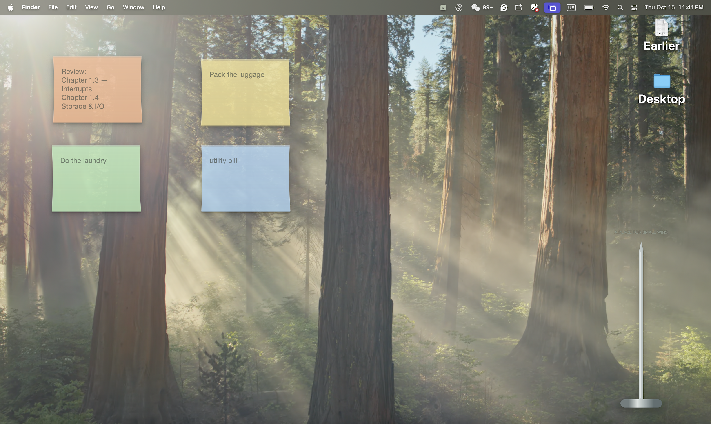
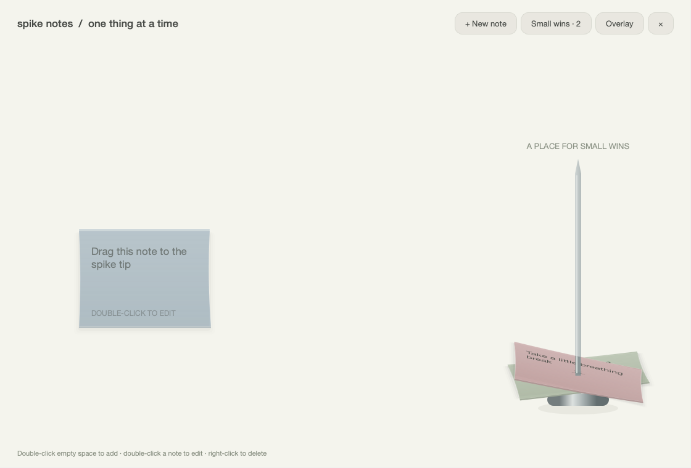

# Spike Notes

English | [简体中文教程](docs/README.zh-CN.md)

Independent desktop sticky notes that collect on a metallic spike when finished.
Built with Python and PySide6. No accounts or online services.



## Run

Requires Python 3.10+ and a desktop operating system supported by PySide6.

```sh
git clone https://github.com/NicoleJiaxinSun/SpikeTasks.git
cd SpikeTasks
python3 -m venv .venv
source .venv/bin/activate
python -m pip install -r requirements.txt
python main.py
```

On Windows, activate with `.venv\Scripts\activate` instead.
Keep the terminal open while the app runs.

## Use

- Drag each independent, transparent note anywhere on your connected screens.
- Right-click the collector or use the **S** menu-bar/system-tray icon and choose
  **＋ New note**. This menu also works when right-clicking completed papers.
- Double-click a note to edit its text and color; right-click it to edit or delete.
- Drag a note's center to the spike tip, then release to complete it. The paper
  pierces, tilts, flutters down, and settles onto the stack.
- Left-click completed papers or choose **Small wins** to restore or delete them.
- Choose **Keep above other windows** to pin notes. By default other apps can
  cover them. Choose **Show all notes** to bring hidden notes back.
- Quit through the collector or tray menu to save and exit.

The collector stays in the bottom-right of the primary screen's available area.
Its shaped input region leaves the transparent surrounding area available for
other desktop interaction. This is a desktop app, not a Finder desktop extension.

## Appearance

Six paper colors: rose pink `#F3BCC6`, peach orange `#F6C29A`, cream yellow
`#F5E69F`, fresh green `#C8EFC1`, mist blue `#B8D8F5`, and soft violet `#D8C5EE`.
Text uses regular 17-point type. The editing hint appears only on hover.
Long text wraps within the fixed-size paper; double-click to read/edit full text.

Completed papers have roughly 8–12 pixels of separation over the first ten wins,
with about 89 pixels of visible stack growth. Larger collections gradually
compress to stay on the rod; all completed notes remain accessible in Small wins.



The images show the application running on a real macOS desktop: active notes
above, and completed notes collected on the spike below.

## Saved data

Notes, colors, positions, and completion state save atomically to `tasks.json` in
Qt's per-user application data folder (`SpikeNotes/Spike Notes`). On macOS this is
under `~/Library/Application Support/`; on Windows under `%APPDATA%`; on Linux
under `~/.local/share/`. Existing eight-color files migrate to the six-color palette.

The first launch includes three demo notes. An intentionally empty board stays
empty. Invalid files are preserved and saving is disabled until the file is
repaired or moved. Avoid running multiple instances against the same data file.

## Verification

```sh
python -m unittest discover -s tests -v
```

Seven automated checks cover storage, editing, dragging, completion/restoration,
independent note scenes, right-click menus, and stack spacing. Tests run offscreen.
Native transparency, window ordering, input regions, and multiple monitors still
need desktop testing. The restricted development runner cannot connect to the
macOS window service; native desktop verification is incomplete.

## Source

- `main.py`: launch entry point
- `spike_notes/app.py`: note rendering, editor, collection animation, retained board view
- `spike_notes/desktop.py`: desktop note windows, collector, and tray menu
- `spike_notes/storage.py`: validation, atomic storage, and palette migration
- `tests/`: offscreen regression checks
